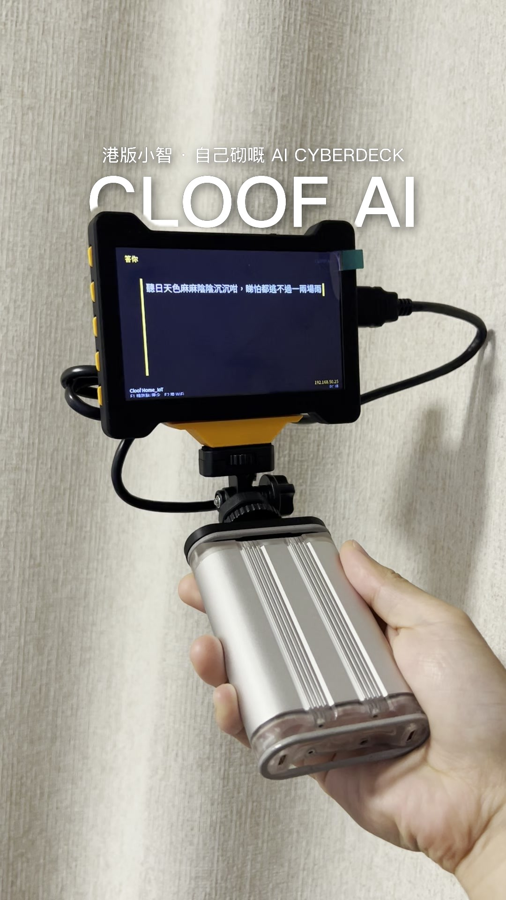

# text-behind-subject

Put **big, modern text BEHIND the subject** in a video — the classic Instagram
Reel effect where a huge title is sandwiched *between the background and the
person/subject*, so the subject partially occludes the letters.

Text style: large CJK-capable sans (PingFang HK by default), **no border, no
box, just a soft blurred drop shadow** — the "modern minimal" reel look.



## How it works

```
source frames ──► SAM2 subject mask (YOLO or box prompts)
                    │  (mask recomputed every N frames, EMA-smoothed)
                    ▼
        composite:  background frame
                    ▼ + text layer (white/amber, soft shadow)
                    ▼ + original subject re-painted through the mask
```

1. **Subject mask** — [SAM2](https://docs.ultralytics.com/models/sam-2/) via
   `ultralytics`. Prompting modes (combinable):
   - `--auto-person`: YOLOv8-nano detects people each refresh, all person boxes
     prompt SAM2 in one batched call, masks are unioned.
   - `--boxes`: you supply box prompts (source pixels) — the right choice for
     **objects/devices** that YOLO can't name.
   - **Both together** = combined mode: persons AND objects occlude the text,
     so the text sits in the depth gap between them (white robots no longer
     wash the white text out — they hide it instead).
2. **Text layer** — PIL. Big main line + small tracked subline, soft Gaussian
   shadow, no stroke, no box. Any TrueType/TTC font; default = macOS PingFang
   (Simplified/Traditional Chinese + Latin all fine).
3. **Optical-flow propagation** — between SAM2 refreshes the mask is warped
   frame-to-frame with Farneback optical flow (`cv2.remap`), so the cut edge
   *moves with the subject* instead of freezing until the next refresh.
   Continuous edges without per-frame SAM2 cost.
4. **Composite** — text (and its shadow) go over the background, then the
   original frame is re-painted through the subject mask, so the subject covers
   the text = the "behind" illusion. No green screen, no manual rotoscoping.
5. **Edge refinement** — the low-res mask is refined in passes:
   - **guided filter** (`cv2.ximgproc.guidedFilter`, r=16) — snaps the mask
     boundary to the *real image edges* of the frame;
   - **per-column top-edge snap + 1D median smoothing** — pulls the mask's top
     boundary onto the strongest horizontal image edge in a small band. This
     removes the systematic "fabric strip" that generous SAM2 box prompts leave
     above the true silhouette (the main cause of loose-looking edges);
   - morphology (close/open, drop small islands) and a tight 1px feather for a
     clean soft cut instead of an aliased staircase.

## The static-camera trick (why this is fast enough on a laptop)

If the camera doesn't move, **you don't need a mask on every frame**. The
subject barely moves relative to the frame, so:

- static / tripod / propped-phone shots → `--every 8..12` (one SAM2 call per
  ⅓–½ second), reuse the mask in between
- handheld sway → `--every 4` plus the built-in EMA blending (0.6 new / 0.4 old)

That's roughly **10× fewer SAM2 calls** than per-frame processing, which makes
CPU-only rendering practical on an Apple-silicon laptop. Zooms / pans / walking
shots defeat the reuse trick — use `--every 1` (slow) or shoot static.

## Install

```bash
pip install ultralytics pillow numpy   # ffmpeg on PATH
```

First run downloads `sam2.1_b.pt` (~154 MB) and `yolov8n.pt` (~6 MB) automatically.

## Usage

```bash
# people (YOLO auto-prompt)
python text_behind.py -i clip.mp4 -t "你好" -s "HELLO REEL" -o out.mp4 \
    --start 2 --duration 4 --auto-person --every 4

# object / device shots (manual box prompts, source pixels)
python text_behind.py -i clip.mp4 -t "跑緊真 Linux" -s "RASPBERRY PI" -o out.mp4 \
    --start 14 --duration 4.5 --boxes "2,2,1800,1000" --every 8

# amber brand accent
python text_behind.py -i clip.mp4 -t "CLOOF AI" -o out.mp4 \
    --auto-person --every 4 --amber
```

Useful flags: `--text-y` / `--sub-y` (position), `--main-size` / `--sub-size`,
`--font` (any TTF/TTC), `--keep-frames` (debug masks/frames).

Picking text position: put the main line so it *crosses the subject's silhouette*
(top of the letters visible on the background, bottom hidden by the subject) —
that's what sells the effect.

## Limitations

- Static or near-static cameras only for the fast path; big camera motion needs
  per-frame masks.
- Crowded scenes / subject similar to background → SAM2 masks need a spot check.
- Edge flicker on fast motion: lower `--every`, and the EMA helps but can't
  fully hide it.
- The mask edge is the only "cutout" quality cue — soft-depth shots
  (shallow DOF) may show a slightly crisp subject edge where the text crosses.
- **Full-frame close-ups don't work**: the effect needs the subject's *edge*
  to cross the text. If the subject fills the whole frame there is no edge to
  straddle — shoot wider or crop so the subject has background around it.
- Moving performers (dancing lion, walking actor) drift out of fixed box
  prompts — use `--auto-person` for people, or re-prompt per refresh.

## Engines (`--engine video|flow`)

**`video` (default)** — the official [SAM2 video predictor](https://github.com/facebookresearch/sam2):
prompt frame 0 ONCE (boxes and/or YOLO person boxes), and the model's memory
module propagates the mask to **every frame with temporal consistency**. This
is what finally fixed the jumping-text problem on moving subjects — the model
tracks the subject itself, no per-frame re-prompting, no optical-flow guessing.
Runs on Apple Metal (MPS ≈ 0.9 s/frame) or CUDA.

Setup: `pip install sam2 decord` (decord = macOS/ARM: feed a frames dir — the
tool extracts numbered frames itself and hard-links them).

**`flow` (legacy)** — the refresh + optical-flow hybrid: SAM2 anchors every
N frames, Farneback warps between. Fine for static cameras, weaker on motion.

⚠ `cv2.calcOpticalFlowFarneback` on this machine returns an all-zero field
for float32 input — the flow engine passes uint8 grays only.

## Edge-hug score (`--report`)

`--report` prints an **edge-hug score**: the mean distance (px) from the mask
boundary to the nearest *real image edge* of the frame — how far the cut line
is from the actual subject. Rough guide: 2-3px = tight; ~100px = soft-edge
sources (dark subject on a white background — usually still looks fine).
Refreshes outside sane bounds get flagged so you know where to look.

Three guards make the pipeline self-healing:

1. **hug-guard on refresh** — a garbage SAM2 anchor (subject fused with a
   foreground graphic) is rejected; the flow-anchored mask carries on.
2. **flow re-verification every frame** — if the flow is hijacked by the
   video's own overlay graphics or a whip pan, the mask re-anchors to the
   last good SAM2 mask instead of smearing.
3. **refined-mask check before compositing** — if the mask still isn't on
   real edges, the subject-over-text paste is skipped so the text stays
   readable.

Hard-won detail: `cv2.calcOpticalFlowFarneback` silently returns an
**all-zero flow for float32 input** on this setup — pass uint8 grays.

## New in this version

- `--color auto` (default): samples the luminance under the text and picks
  white (dark frame) or near-black (light frame) — no more invisible text on
  bright backdrops.
- `--conf`: YOLO confidence. Lower it when the subject is clipped (head out
  of frame) — YOLO often drops body-only detections entirely.
- `--report` + the three guards above.

## Real-world result

Rendered on an M1 MacBook Pro (CPU only, SAM2 base): ~50 SAM2 refreshes for a
~13 s / 24 fps three-shot reel — a few minutes end-to-end including encode.
On a CUDA GPU the same job is seconds.

## Credits

- [Ultralytics SAM2 / YOLOv8](https://github.com/ultralytics/ultralytics) (AGPL-3.0)
- [Pillow](https://python-pillow.org/), [FFmpeg](https://ffmpeg.org)

Technique + tooling by [Cloof Siu](https://cv.cloofsiu.com) — robotics educator
from Hong Kong. MIT licensed (see [LICENSE](LICENSE)); note the ultralytics
models keep their own AGPL license.

## See also

The example reel built with this tool (Raspberry Pi cyberdeck, text behind the
device on three static shots) is in `example/`.
